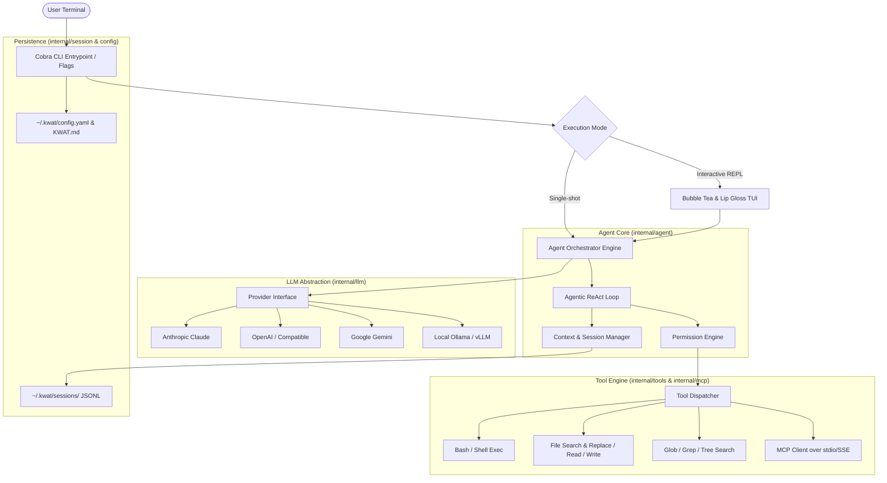

# Master Architecture & Implementation Plan: KWAT CLI Agent

> **KWAT** adalah CLI Coding Assistant cerdas berbasis Golang yang dirancang untuk automasi alur kerja pengkodean lokal, eksekusi shell yang aman, navigasi repositori cerdas, dan modifikasi kode presisi menggunakan antarmuka terminal interaktif.

---

## 1. Arsitektur Sistem (High-Level Architecture)



---

## 2. Struktur Proyek (Clean Architecture in Go)

```text
kwat/
├── cmd/
│   └── kwat/
│       └── main.go                 # Entrypoint utama aplikasi
├── internal/
│   ├── agent/                      # Core ReAct loop, state machine, prompt templates
│   │   ├── agent.go
│   │   ├── loop.go
│   │   ├── prompts.go              # System prompts & instruction injection
│   │   └── types.go
│   ├── config/                     # Viper configuration & project rule loader (KWAT.md)
│   │   ├── config.go
│   │   └── rules.go
│   ├── llm/                        # Multi-provider LLM abstraction & streaming
│   │   ├── provider.go             # Interface Provider (StreamChat, ToolCall definition)
│   │   ├── anthropic/
│   │   ├── openai/
│   │   ├── gemini/
│   │   └── ollama/
│   ├── tools/                      # Native tool definitions & implementations
│   │   ├── registry.go             # Registry & tool execution schemas
│   │   ├── bash.go                 # Command execution dengan timeout & output capture
│   │   ├── file_read.go            # Line-range reader
│   │   ├── file_write.go           # File creation / write
│   │   ├── file_edit.go            # Search & replace block engine
│   │   ├── grep.go                 # Regex search across project
│   │   └── glob.go                 # File pattern matcher
│   ├── permission/                 # Security policy & approval handlers
│   │   ├── policy.go               # Granular, Strict, Sandbox, FullAuto
│   │   └── approval.go             # Interactive approval prompt
│   ├── session/                    # Session persistence & auto-compaction
│   │   ├── session.go
│   │   ├── store.go                # JSONL session logging & resume
│   │   └── compactor.go            # Context summarization engine
│   ├── mcp/                        # Model Context Protocol integration
│   │   ├── client.go
│   │   └── transport.go            # stdio / JSON-RPC 2.0
│   └── tui/                        # Rich Terminal User Interface (Charmbracelet)
│       ├── app.go                  # Bubble Tea model & update loop
│       ├── view.go                 # Lip Gloss rendering & markdown formatting
│       ├── spinner.go              # Loading indicators
│       └── keybinds.go
├── pkg/
│   └── diff/                       # Helper syntax diff & fuzzy string matching
├── go.mod
├── go.sum
└── Makefile
```

---

## 3. Komponen Utama & Desain Spesifikasi

### 3.1. Abstraksi LLM Provider
Interface terpadu untuk semua model:
```go
type Message struct {
    Role       Role // System, User, Assistant, Tool
    Content    string
    ToolCalls  []ToolCall
    ToolResult *ToolResult
}

type Provider interface {
    Name() string
    StreamChat(ctx context.Context, req ChatRequest, chunkChan chan<- StreamChunk) (*ChatResponse, error)
    SupportedTools() bool
}
```

### 3.2. File Editing Engine (Search & Replace Block)
Model berinteraksi via tool `edit_file`:
```json
{
  "path": "internal/auth/auth.go",
  "old_str": "func VerifyToken(t string) bool {\n    return t != \"\"\n}",
  "new_str": "func VerifyToken(t string) (bool, error) {\n    if t == \"\" {\n        return false, ErrEmptyToken\n    }\n    return true, nil\n}"
}
```
*   **Exact Matching**: Mencari target teks persis dengan whitespace.
*   **Fuzzy Fallback**: Jika indentasi tabs vs spaces berbeda, engine mencocokkan baris ternormalisasi untuk menghindari kegagalan edit semata karena spasi.
*   **Atomic Write**: Penulisan file menggunakan temp file dan rename untuk mencegah rusaknya file jika terjadi interupsi.

### 3.3. Sistem Keamanan & Izin (Configurable Security Profiles)
KWAT mendukung 4 profil izin yang dapat diatur via flag `--permission-mode` atau `config.yaml`:
1.  **Granular (Default)**: Auto-approve tools baca (`read_file`, `glob`, `grep`), konfirmasi eksplisit sebelum menjalankan `bash` atau `edit_file`. User dapat memilih `[y]es / [n]o / [a]lways for session`.
2.  **Strict**: Mengharuskan konfirmasi untuk setiap tool tanpa terkecuali.
3.  **Sandbox / Dry-run**: Menampilkan diff perubahan kode dan preview command shell tanpa langsung menulis ke file asli atau menjalankan efek samping.
4.  **Full Auto (`--dangerously-skip-permissions` / `auto`)**: Eksekusi otomatis tanpa konfirmasi interaktif (cocok untuk automasi CI/CD atau script).

### 3.4. Codebase Intelligence yang Efisien
*   **Zero-index startup**: Tidak memerlukan database embedding awal yang berat.
*   **Dynamic Tooling**: Model secara mandiri menggunakan `glob` untuk mencari nama file, `grep` untuk mencari definisi fungsi, dan `read_file` dengan rentang baris (`StartLine`, `EndLine`).
*   **Git Awareness**: Otomatis menyuntikkan ringkasan `git status` dan branch aktif ke dalam system prompt awal agar model mengetahui konteks perubahan terakhir.

### 3.5. Session Persistence & Context Compaction
*   Riwayat percakapan disimpan secara atomik dalam format JSONL di `~/.kwat/sessions/<session-id>.jsonl`.
*   Token tracker memantau konsumsi token pada setiap turn.
*   Jika token context window mencapai ambang batas (misal: 80% dari model limit), sistem otomatis memanggil sub-summarization untuk memadatkan pesan-pesan terdahulu menjadi *condensed summary checkpoint*, menjaga agar agen tetap efisien dan tidak crash.
*   Perintah pendukung: `/compact` (manual kompresi), `/resume` (melanjutkan sesi terakhir), `/cost` (estimasi biaya token).

### 3.6. Ekstensibilitas (KWAT.md & MCP)
*   **Project Instructions**: Jika file `KWAT.md` atau `.kwat/rules` ditemukan di root repositori, kontennya otomatis disuntikkan ke dalam instruksi agen (misal: aturan linting, arsitektur proyek, testing guidelines).
*   **MCP (Model Context Protocol)**: Kwat bertindak sebagai MCP Host/Client yang dapat membaca konfigurasi server MCP (seperti PostgreSQL inspector, Brave search, GitHub MCP) dan mendaftarkan tools eksternal ke dalam LLM loop.

---

## 4. Rencana Implementasi Bertahap (Roadmap)

| Fase | Fokus | Deliverables |
| :--- | :--- | :--- |
| **Fase 1** | **Scaffolding & CLI Core** | Inisialisasi Go module, struktur folder clean architecture, setup Cobra CLI & Viper config, logging, dan Makefile. |
| **Fase 2** | **LLM Abstraction & Basic ReAct Loop** | Provider interface, implementasi OpenAI/Anthropic/Gemini streaming client, loop ReAct sederhana. |
| **Fase 3** | **Native Tools & Permission Engine** | Implementasi `bash`, `read_file`, `write_file`, `edit_file` (search & replace), `grep`, `glob`, dan konfigurasi izin eksekusi (`granular`, `strict`, `auto`). |
| **Fase 4** | **Rich TUI & Interactive REPL** | Implementasi Bubble Tea & Lip Gloss untuk streaming markdown, syntax-highlighted diffs, spinners, dan interactive approval prompts. |
| **Fase 5** | **Session, Compaction & MCP Extension** | Persistence JSONL di `~/.kwat/sessions/`, context compactor, slash commands (`/init`, `/compact`, `/help`), dan client MCP. |

---

## 5. Rekomendasi Tech Stack & Dependensi Go

*   **CLI Framework**: `github.com/spf13/cobra` & `github.com/spf13/viper`
*   **TUI & Styling**:
    *   `github.com/charmbracelet/bubbletea` (TUI runtime)
    *   `github.com/charmbracelet/lipgloss` (Styling & layout)
    *   `github.com/charmbracelet/bubbles` (Components: spinners, textinput, viewport)
    *   `github.com/alecthomas/chroma/v2` (Syntax highlighting)
*   **File Matching & Diffing**:
    *   `github.com/bmatcuk/doublestar/v4` (Glob matcher)
    *   `github.com/sergi/go-diff/diffmatchpatch` (Diff preview & fuzzy matching)
*   **LLM & MCP**:
    *   HTTP client native Go dengan SSE decoder untuk multi-provider
    *   Model Context Protocol (JSON-RPC over stdio)
